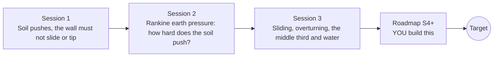

# openretainingwall

[](https://github.com/KrunalPanchal1995/openretainingwall/actions/workflows/ci.yml)   [](https://colab.research.google.com/github/KrunalPanchal1995/openretainingwall/blob/main/sessions/session-01/lesson.ipynb) [](https://krunalpanchal1995.github.io/openretainingwall/)

**Check a retaining wall against sliding and overturning, in three sessions.**

openretainingwall teaches how soil pushes on a wall and how an engineer asks 'will it slide, will it tip?', using only Python and a browser.

- **Start from zero.** Session 1 needs only school arithmetic and the idea of a turning effect; every symbol is explained.
- **See it push.** Every session ships a slider app that runs in the browser, with labelled graphs and force arrows.
- **Know you got it right.** Each session ends with a checkpoint that prints PASS or FAIL against hand calculations and closed forms.
- **Build the missing half.** The repo stops at Session 3 on purpose; the roadmap shows the path to the Target.

[Target](#the-target) · [Who is this for](#who-is-this-for) · [Quick start](#quick-start) · [Sessions](#sessions) · [Roadmap](#roadmap) · [Contribute](#contribute) · [Explainer PDF](docs/explainer.pdf)

> **This repo is incomplete on purpose.** Sessions 1 to 3 are here and fully working. The finished Target below is a preview of what the community can build next. We show you the path, not the code. Sessions 4 and up are yours.

## The Target

A retaining wall cross-section while the water level rises in the backfill. The soil and water pressure diagram grows, force arrows lengthen, and two bars show the sliding and overturning safety factors falling through their limits (1.5 and 2.0) towards 1.0. Your goal over the coming sessions: build that animation yourself and then add a drain that saves the wall.


*Target: a wall as the water rises in the backfill, with force arrows and the safety factors falling below their limits*


*Target still: the wall near the point where overturning safety falls to 1*

Try it live:

- [Math Visual Studio: free-body diagrams (Atlas S37)](https://krunalpanchal1995.github.io/studio/#atlas?ch=S37&ex=1)
- [Math Visual Studio: friction (Atlas S42)](https://krunalpanchal1995.github.io/studio/#atlas?ch=S42&ex=1)

How the Target was made is shown only as a path in [promo/roadmap.md](promo/roadmap.md).

## Who is this for
**diploma / undergraduate to advanced undergraduate (levels 5-6).** Topic area: Civil Engineering and Construction.

Prerequisites:

- School arithmetic, the idea of area of a triangle, and the idea of a turning effect (force times distance).
- Python 3.10 or newer; if `python --version` works, you are ready. PRIMER.md explains the rest.
- No prior GitHub, soil mechanics or structures experience is needed.

New to Python? Read [PRIMER.md](PRIMER.md) first (10 minutes).

## Quick start

No installation knowledge needed. You need [Git](https://git-scm.com/downloads) and [Python 3.10+](https://www.python.org/downloads/) (Windows: tick "Add Python to PATH"). On Mac and Linux type `python3` wherever this page says `python`.

```bash
git clone https://github.com/KrunalPanchal1995/openretainingwall.git
cd openretainingwall
python start.py 1
```

`start.py` creates a private environment, installs what is needed and runs Session 1 with its checkpoint. Next: `python start.py 2`, `python start.py 3`, or `python start.py test` to check everything. Only a checkpoint: `python start.py check 1`.

Four lines turn the idea of Session 2 into a result (they work as they are): Save it as `try.py` and run it with `python start.py run try.py` (this uses the private environment, where NumPy is installed):

```python
import numpy as np
phi = np.radians(30)
Ka = (1 - np.sin(phi)) / (1 + np.sin(phi))      # Rankine active coefficient
print(round(Ka, 4), round(0.5 * Ka * 18 * 4**2, 1))   # -> 0.3333 48.0 kN per metre of wall
```

Every session also opens in your browser with sliders (no install): [live apps](https://krunalpanchal1995.github.io/openretainingwall/). Or use the Colab badge above for the notebook.

## Sessions

| # | Session | Model level | Time | Live app |
|---|---|---|---|---|
| 1 | [Soil pushes, the wall must not slide or tip](sessions/session-01/README.md) | Level 1: conceptual interactive model | 60 min | [open](https://krunalpanchal1995.github.io/openretainingwall/session-01/) |
| 2 | [Rankine earth pressure: how hard does the soil push?](sessions/session-02/README.md) | Level 2: mathematical engineering model | 75 min | [open](https://krunalpanchal1995.github.io/openretainingwall/session-02/) |
| 3 | [Sliding, overturning, the middle third and water](sessions/session-03/README.md) | Level 3: simulation and validation | 90 min | [open](https://krunalpanchal1995.github.io/openretainingwall/session-03/) |

Each session follows the same six steps: A real-world problem, B concept and theory, C visual explanation, D interactive simulation, E worked example and experiment, F assessment and design challenge. Each ends with `checkpoint.py`, which prints `PASS` or `FAIL` against reference numbers. Session 3 also contains the real-world mini-project: **Size the base width of a small garden wall**.

## Architecture



| Folder or file | What is inside |
|---|---|
| `sessions/` | three sessions: README (A-F), `lesson.py`, notebook, live app, exercises, activity sheet, checkpoint |
| `promo/` | the Target: media, live links, and the roadmap (path only) |
| `docs/` | `explainer.tex` and the built `explainer.pdf` |
| `tests/` | runs every lesson and checkpoint headless |
| `start.py` | one command to set up and run anything |
| `QUALITY.md`, `RUBRIC.md` | the quality checklist and the scoring rubric |
| `.github/` | CI, PDF build, Pages deploy, issue and PR templates |

## Roadmap

| Milestone | What you will build | Difficulty |
|---|---|---|
| Session 4: Cantilever wall with a heel slab | A wall made of a stem and a base slab, with the weight of soil on the heel included. | intermediate |
| Session 5: Passive resistance and a shear key | A passive force at the toe and a key under the base added to the sliding check. | intermediate |
| Session 6: A drain that saves the wall | A drainage model that sets the effective water level behind the wall from rain and drain capacity. | advanced |
| Session 7: Bearing capacity of the ground | A check of the toe pressure against an allowable bearing pressure. | advanced |
| Session 8: Earthquake loading | A function Kae for a horizontal acceleration coefficient and a check of the wall under it. | advanced |

Full detail with a checkpoint per milestone: [promo/roadmap.md](promo/roadmap.md).

## Contribute
New to GitHub? Read [CONTRIBUTING.md](CONTRIBUTING.md); it starts from zero. Pick an issue labelled `good first issue`. Translations into Hindi, Telugu, Tamil and Malayalam are welcome.

<details>
<summary>Development</summary>

```bash
python start.py test        # runs every lesson and checkpoint
```
Lessons use `# %%` cell markers so they open as notebooks in VS Code. See [QUALITY.md](QUALITY.md) for the standard every session meets.
</details>

## License
MIT. See [LICENSE](LICENSE). Media in `promo/media` is (c) Krunal Panchal, CC BY 4.0.

## Acknowledgments
Part of the [PAN IIT OSS](https://hellofoss.tech-iitb.org/projects) open-source teaching collection, modelled on the structure of [openspline](https://github.com/openspline/openspline). Built on ideas from the Math Visual Studio at https://krunalpanchal1995.github.io/studio/.
