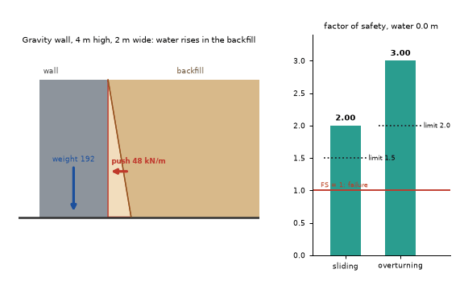
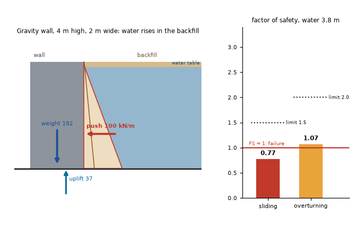

# What you are building toward

A retaining wall cross-section while the water level rises in the backfill. The soil and water pressure diagram grows, force arrows lengthen, and two bars show the sliding and overturning safety factors falling through their limits (1.5 and 2.0) towards 1.0. Your goal over the coming sessions: build that animation yourself and then add a drain that saves the wall.

*Target: a wall as the water rises in the backfill, with force arrows and the safety factors falling below their limits*

*Target still: the wall near the point where overturning safety falls to 1*

These results come from a private reference build. The code is not published; the roadmap shows the path so you can build your own.

Live links:

- [Math Visual Studio: free-body diagrams (Atlas S37)](https://krunalpanchal1995.github.io/studio/#atlas?ch=S37&ex=1)
- [Math Visual Studio: friction (Atlas S42)](https://krunalpanchal1995.github.io/studio/#atlas?ch=S42&ex=1)
