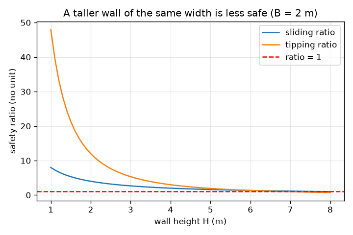
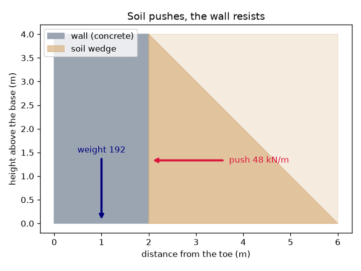

# Session 1: Soil pushes, the wall must not slide or tip

*Level 1 (conceptual interactive model) · about 60 minutes · openretainingwall*

> This is a simplified educational model. It is not a validated design tool and must not be used for real structures, electrical installations, vehicles, industrial processes or medical decisions.

**Prerequisites**

- School arithmetic and the area of a triangle.
- You have read PRIMER.md and run `python start.py 1` once.

**Learning objectives.** After this session you can:

- Explain why soil pushes sideways on a wall and why the push grows with depth.
- Compute the push and the wall weight per metre of wall for a simple rectangular wall.
- Use a sliding ratio and a tipping ratio to judge whether a wall is safe.
- Read a graph of the two ratios against wall height.

## A. Real-world problem
A garden bed behind a low wall looks calm, but the soil is like a heavy crowd leaning on a fence: it wants to spread out sideways. The deeper the soil, the harder it pushes, so a tall wall faces much more than a short one. The wall can fail in two simple ways: the whole wall can slide along the ground, or it can tip over its front bottom edge, the toe. How strong must a wall of a given width be?

## B. Concept and theory
The sideways pressure of the soil is zero at the surface and grows in a straight line with depth, so the pressure on the wall back is a triangle. The force is the area of that triangle. In this session we use a push factor Ka = 1/3 (Session 2 explains where it comes from), a soil unit weight of 18 kN/m^3 and a wall height H, which gives a push per metre of wall of 0.5 x (1/3) x 18 x H^2, acting one third of the way up. The wall is a concrete rectangle of width B and weighs 24 x B x H per metre; friction under the base resists sliding with a coefficient of 0.5. Sliding ratio = friction / push. Tipping ratio = (weight x B/2) / (push x H/3): the turning effect that keeps the wall down divided by the turning effect that tips it, both about the toe. A ratio below 1 means failure; engineers want a margin of at least about 1.5 for sliding and 2 for tipping (commonly used guidance, not a code).

| Symbol | Meaning | Unit |
|---|---|---|
| H | wall height (retained soil height) | m |
| B | wall width at the base | m |
| P | total sideways push of the soil per metre run of wall | kN/m |
| W | wall weight per metre run | kN/m |
| gamma | soil unit weight (18) | kN/m^3 |
| Ka | push factor (1/3 here) | no unit |
| mu | friction coefficient under the base (0.5) | no unit |

**Assumptions**

- The wall is a solid rectangle of concrete with unit weight 24 kN/m^3.
- The soil is dry, level at the wall top and gives the push factor 1/3.
- Only the base friction resists sliding; the soil in front of the toe is ignored.
- This is a simplified teaching model, never a design method for a real wall.

$$ P=\tfrac12 K_a\gamma H^2,\qquad \text{acts at } H/3 \text{ above the base} $$

$$ W=\gamma_c B H $$

$$ \text{sliding ratio}=\frac{\mu W}{P},\qquad \text{tipping ratio}=\frac{W\,B/2}{P\,H/3} $$

## C. Visual explanation
The first figure shows the wall in grey-blue, the soil behind it, the push arrow at one third of the height and the weight arrow through the middle of the base. The second plots both ratios against the wall height for a 2 m wide wall: they fall as the wall gets taller because the push grows with H squared while the weight grows only with H. The tipping ratio crosses 1 at about 6.9 m and the sliding ratio at 8 m.

*Sliding and tipping ratios against wall height for a 2 m wide wall: both fall as the wall gets taller.*

*A 4 m wall: the soil pushes with 48 kN/m at one third of the height; the weight is 192 kN/m.*

## D. Interactive simulation
Run the lesson (`python start.py 1`), then open the live app: [Session 1: will the wall slide or tip?](https://krunalpanchal1995.github.io/openretainingwall/session-01/) (or `app.html` in this folder). Slide the wall height up and down and watch the push arrow grow faster than the wall. Then widen the wall and watch both ratios rise.

**Challenge.** Build a wall at least 5 m high that has a sliding ratio of at least 1.5 and a tipping ratio of at least 2.

## E. Worked example and experiment
**Problem.** A wall 4 m high and 2 m wide holds dry soil. Find the push, the weight, the sliding ratio and the tipping ratio.

1. Push P = 0.5 x (1/3) x 18 x 4^2 = 0.5 x 0.3333 x 18 x 16 = 48 kN/m, acting 4/3 = 1.33 m above the base.
2. Weight W = 24 x 2 x 4 = 192 kN/m, acting 1 m from the toe.
3. Sliding: friction = 0.5 x 192 = 96 kN/m, so the ratio is 96 / 48 = 2.00.
4. Tipping: resisting turning effect = 192 x 1 = 192 kN m/m; tipping turning effect = 48 x 1.333 = 64 kN m/m; the ratio is 192 / 64 = 3.00.

**Answer.** Push 48 kN/m, weight 192 kN/m, sliding ratio 2.00, tipping ratio 3.00. Both are above the guidance values of 1.5 and 2.

**Experiment.** Fill a shoe box with dry sand to a depth of 10 cm, lean a thin wooden board against a sand-filled side and slowly tilt the box. Try boards of different weight: a heavier or wider block resists longer. The model predicts that doubling the sand depth quadruples the push (it does: 48 kN/m becomes 192 kN/m for an 8 m wall). Real sand is not exactly the simple triangle of the model, the board is not rigid and the friction on the table varies, so expect only a rough agreement in trend.

## F. Assessment and design challenge
**Question type A: Conceptual.** Why does doubling the height of the soil quadruple the push on the wall, but only double the weight of a wall of the same width?

Hint

The push is the area of a triangle whose base and height both grow with H. The weight is width times height.

Step-by-step solution

The pressure at the bottom doubles (it is proportional to depth) and the loaded height doubles, so the triangle's area is four times larger: 48 kN/m becomes 192 kN/m. The wall weight W = 24 x B x H only has one factor of H, so it doubles. That is why a taller wall of the same width is much less safe.

**Question type B: Numerical.** A wall 3 m high and 1.2 m wide holds dry soil (same values as in the lesson). Find the sliding ratio and the tipping ratio. Does it meet the guidance of 1.5 and 2?

Hint

P = 0.5 x (1/3) x 18 x 9 = 27 kN/m acting at 1 m; W = 24 x 1.2 x 3.

Step-by-step solution

W = 86.4 kN/m. Sliding ratio = 0.5 x 86.4 / 27 = 1.60. Tipping ratio = 86.4 x 0.6 / (27 x 1) = 51.84 / 27 = 1.92. Sliding meets 1.5, but the tipping ratio 1.92 is just below 2, so the wall is slightly too narrow.

**Question type C: Graph and simulation interpretation.** In the graph for a 2 m wide wall, at what heights do the two ratios reach 1? Which failure comes first as the wall gets taller?

Hint

Read where each curve touches the red line. Closed forms: sliding ratio = 4B/H, tipping ratio = 12 B^2 / H^2.

Step-by-step solution

The tipping ratio reaches 1 at H = sqrt(48) = 6.93 m and the sliding ratio at H = 8 m. As the wall gets taller, tipping fails first, at about 6.9 m. In practice the guidance values 1.5 and 2 are exceeded long before: a wall of this width stops meeting them at much lower heights.

**Question type D: Design and optimisation challenge.** Design: for a 3 m high wall choose the smallest width, in steps of 0.05 m, that gives a sliding ratio of at least 1.5 and a tipping ratio of at least 2. Which ratio decides?

Hint

Sliding needs 4B/H >= 1.5 and tipping needs 12 B^2 / H^2 >= 2. Solve each for B.

Step-by-step solution

Sliding: B >= 1.5 x 3 / 4 = 1.125 m. Tipping: B >= 3 x sqrt(2/12) = 1.225 m. Both must hold, so the width is 1.25 m (1.20 m gives a tipping ratio of 1.92, too low). Tipping decides. Trade-off: a wider wall costs more concrete; 1.25 m instead of 1.20 m is about 4 percent more.

Score yourself with [RUBRIC.md](../../RUBRIC.md). Print the [activity sheet](activity_sheet.md) to work on paper.

## Common misconceptions
| Common misconception | What is actually true |
|---|---|
| The soil only presses down on the ground, not sideways. | Soil is a granular material: it pushes sideways like a heavy fluid with a smaller push factor, and the pressure grows with depth. |
| A taller wall needs only proportionally more width. | The push grows with the square of the height, so the width needed grows roughly in proportion to the height, not the weight alone. |
| If the wall does not slide it cannot fail. | It can also tip about its toe; sliding and tipping are separate checks. |
| A ratio of exactly 1 is safe. | A ratio of 1 means the wall is on the edge of failing; real data are uncertain, so engineers want a margin. |

## Glossary
- **retaining wall**: a wall built to hold back soil
- **toe**: the front bottom edge of the wall, the pivot about which it tips
- **backfill**: the soil placed behind the wall
- **push factor Ka**: fraction of the soil weight pressure that appears as sideways pressure; 1/3 here
- **kN per metre**: force per metre length of wall, the usual unit for a long wall

## Finish
1. Do the three coding tasks in [exercises.md](exercises.md).
2. Run `python start.py 1` again after your changes. It ends with the checkpoint; when it prints `PASS`, you are done. (Checkpoint only: `python start.py check 1`.)

Next: [Session 2](../session-02/README.md)
