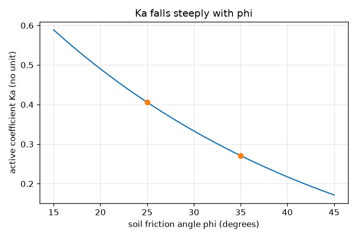
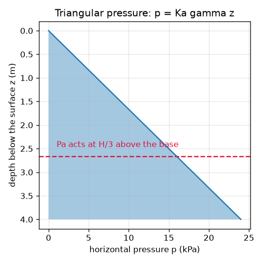

# Session 2: Rankine earth pressure: how hard does the soil push?

*Level 2 (mathematical engineering model) · about 75 minutes · openretainingwall*

> This is a simplified educational model. It is not a validated design tool and must not be used for real structures, electrical installations, vehicles, industrial processes or medical decisions.

**Prerequisites**

- Session 1: the push as a triangle.
- Basic trigonometry: tan and sin of an angle.

**Learning objectives.** After this session you can:

- Compute the Rankine active coefficient Ka for a given friction angle in two equivalent forms.
- Compute the pressure at any depth, the resultant force and where it acts.
- Add the effect of a surcharge and of water as separate contributions.
- Solve an inverse design problem and judge how sensitive the push is to the friction angle.

## A. Real-world problem
A 4 m high wall holds back dry soil. How large is the sideways push, per metre of wall, and where does it act? What changes when a parked car adds weight on the soil, or when heavy rain fills the backfill with water? And how sure can we be of the answer when the friction angle of the soil is only roughly known?

## B. Concept and theory
The Rankine theory treats a smooth vertical wall and level backfill. When the wall moves slightly away from the soil, the soil reaches its active state and the horizontal pressure at depth z is p = Ka x gamma x z. The coefficient Ka depends only on the soil friction angle phi: Ka = tan^2(45 - phi/2), which equals (1 - sin phi) / (1 + sin phi). For phi = 30 degrees, Ka = 1/3. The pressure is a triangle, so the resultant per metre of wall is its area, Pa = 0.5 Ka gamma H^2, acting at H/3 above the base. A uniform surcharge q on the ground adds a constant pressure Ka q, a rectangle, so a force Ka q H at H/2. Water in the backfill pushes with the full hydrostatic pressure gamma_w z whatever the soil; for a backfill saturated to the top the soil's effective weight drops to gamma_sat - gamma_w and the water adds 0.5 gamma_w H^2. Water is a warning: with gamma_sat = 20 kN/m^3 it more than doubles the push on a 4 m wall.

| Symbol | Meaning | Unit |
|---|---|---|
| phi | soil friction angle | degrees |
| Ka | Rankine active earth pressure coefficient | no unit |
| gamma | soil unit weight | kN/m^3 |
| z | depth below the soil surface | m |
| p | horizontal earth pressure | kPa (kN/m^2) |
| Pa | resultant active force per metre run of wall | kN/m |
| q | uniform surcharge on the ground | kPa |
| gamma_w | unit weight of water (9.81) | kN/m^3 |

**Assumptions**

- Smooth vertical wall and level backfill (Rankine).
- Cohesionless, homogeneous soil.
- The wall can move slightly, so the active state is reached.
- For water: a saturated unit weight of 20 kN/m^3, water to the top of the wall and no flow. This is a simplified teaching model, never a design method.

$$ K_a=\tan^2\!\left(45^\circ-\tfrac{\varphi}{2}\right)=\frac{1-\sin\varphi}{1+\sin\varphi} $$

$$ p(z)=K_a\gamma z,\qquad P_a=\tfrac12 K_a\gamma H^2\ \text{at } H/3 $$

$$ P_q=K_a\,q\,H\ \text{at } H/2 $$

$$ P_w=\tfrac12\gamma_w H^2,\qquad P_{soil}=\tfrac12 K_a(\gamma_{sat}-\gamma_w)H^2 $$

## C. Visual explanation
The first figure shows the pressure on the wall back of a 4 m wall: a triangle from zero at the top to 24 kPa at the base, whose area is 48 kN/m and whose centre is one third of the height above the base. The second figure plots Ka against phi. The curve is steep: going from 25 degrees to 35 degrees lowers Ka from 0.406 to 0.271, a drop of about one third, so a poor estimate of phi is a poor estimate of the push.

*Ka against the friction angle: the dots show phi = 25 and 35 degrees.*

*Triangular earth pressure on a 4 m wall: 24 kPa at the base, resultant 48 kN/m at H/3.*

## D. Interactive simulation
Run the lesson (`python start.py 2`), then open the live app: [Session 2: Rankine earth pressure](https://krunalpanchal1995.github.io/openretainingwall/session-02/) (or `app.html` in this folder). Change the wall height and the friction angle and watch the pressure shape and the total force. Add a surcharge to see a rectangle added to the triangle, and switch on saturation to see water more than double the push.

**Challenge.** Keep a dry 4 m wall's push at or below 40 kN/m by choosing a stronger soil (a higher friction angle).

## E. Worked example and experiment
**Problem.** A wall 4 m high holds dry soil with gamma = 18 kN/m^3 and phi = 30 degrees. Find Ka, the pressure at the base, the force per metre and where it acts. Then add a 10 kPa surcharge.

1. Ka = (1 - sin 30) / (1 + sin 30) = 0.5 / 1.5 = 1/3. The other form tan^2(45 - 15) = tan^2(30) = 0.5774^2 = 0.3333 agrees.
2. Pressure at the base = Ka x gamma x H = (1/3) x 18 x 4 = 24 kPa.
3. Force Pa = 0.5 x 24 kPa x 4 m = 48 kN/m, acting 4/3 = 1.33 m above the base.
4. Surcharge force = Ka q H = (1/3) x 10 x 4 = 13.33 kN/m, acting at 2 m.
5. Total = 48 + 13.33 = 61.33 kN/m. Its height = (48 x 1.333 + 13.33 x 2) / 61.33 = (64 + 26.67) / 61.33 = 1.48 m.

**Answer.** Ka = 1/3, base pressure 24 kPa, Pa = 48 kN/m acting 1.33 m above the base; with a 10 kPa surcharge the total is 61.33 kN/m acting 1.48 m above the base.

**Experiment.** Compare with a tall transparent box filled with dry sand and a thin side plate held by a spring balance: the reading grows roughly with the square of the sand depth. The model also says that wetting the sand adds the water push. A real measurement differs because the plate is not perfectly smooth or free to move, the sand packing changes the friction angle, and a small movement of the wall is needed to reach the active state; so the model gives the trend and an estimate, not a precise number.

## F. Assessment and design challenge
**Question type A: Conceptual.** Why is the earth pressure on a wall a triangle, and why does the resultant act at H/3 above the base rather than at mid-height?

Hint

The pressure p = Ka gamma z starts at zero at the top. Where is the centre of area of a triangle?

Step-by-step solution

Because the vertical stress in the soil grows in proportion to depth and the horizontal pressure is a fixed fraction Ka of it, the pressure is zero at the top and largest at the base. The resultant acts through the centroid of that triangle, which is one third of the height above its wide end, so H/3 above the base. A uniform rectangle (the surcharge) would act at H/2.

**Question type B: Numerical.** A wall 3 m high holds soil with gamma = 19 kN/m^3 and phi = 30 degrees. Find Pa and the height at which it acts.

Hint

Ka = 1/3. Pa = 0.5 x Ka x gamma x H^2.

Step-by-step solution

Pa = 0.5 x (1/3) x 19 x 9 = 28.5 kN/m, acting at H/3 = 1.0 m above the base. Sanity check: it is smaller than the 48 kN/m of the 4 m wall, as it should be for a lower wall.

**Question type C: Graph and simulation interpretation.** From the graph of Ka against phi, what happens to Ka when phi rises from 25 to 35 degrees? What does this mean for the 4 m wall's push?

Hint

Read Ka at 25 and 35 degrees; then multiply by 0.5 x 18 x 16 = 144 kN/m.

Step-by-step solution

Ka falls from 0.4059 to 0.2710, about one third lower. The push falls from 58.4 kN/m to 39.0 kN/m. A 10 degree uncertainty in the friction angle changes the load by about 50 percent of the lower value, so wall designs use cautious soil parameters.

**Question type D: Design and optimisation challenge.** Design: the wall may carry at most 60 kN/m of soil force. Find the tallest wall for gamma = 18 kN/m^3 and phi = 30 degrees, first without and then with a 10 kPa surcharge. Which is the stronger limit?

Hint

Without surcharge solve 0.5 Ka gamma H^2 = 60. With surcharge solve 3 H^2 + (10/3) H - 60 = 0.

Step-by-step solution

Without a surcharge H = sqrt(2 x 60 / (18/3)) = sqrt(20) = 4.47 m. With the 10 kPa surcharge the quadratic gives H = 3.95 m. The surcharge costs about half a metre of wall height; the trade-off is between limiting what can be placed on the soil and building a stronger wall.

Score yourself with [RUBRIC.md](../../RUBRIC.md). Print the [activity sheet](activity_sheet.md) to work on paper.

## Common misconceptions
| Common misconception | What is actually true |
|---|---|
| Earth pressure is the same at every depth. | It is zero at the surface and grows in proportion to depth, giving a triangle. |
| The two forms of Ka are different formulas. | tan^2(45 - phi/2) and (1 - sin phi)/(1 + sin phi) are the same number for every phi. |
| Water in the backfill adds only a little. | A saturated 4 m backfill gives 105.7 kN/m against 48.0 kN/m dry, more than twice the push. |
| A better soil (higher phi) pushes harder. | A higher friction angle lowers Ka, so the push falls. |

## Glossary
- **active state**: the soil condition when the wall moves slightly away and the soil pressure is at its minimum
- **Rankine theory**: earth pressure for a smooth vertical wall and level backfill
- **friction angle phi**: an angle describing how strongly the soil grains resist sliding on each other
- **surcharge**: an extra load on the ground behind the wall
- **hydrostatic pressure**: pressure of water, equal to its unit weight times depth

## Finish
1. Do the three coding tasks in [exercises.md](exercises.md).
2. Run `python start.py 2` again after your changes. It ends with the checkpoint; when it prints `PASS`, you are done. (Checkpoint only: `python start.py check 2`.)

Next: [Session 3](../session-03/README.md)
