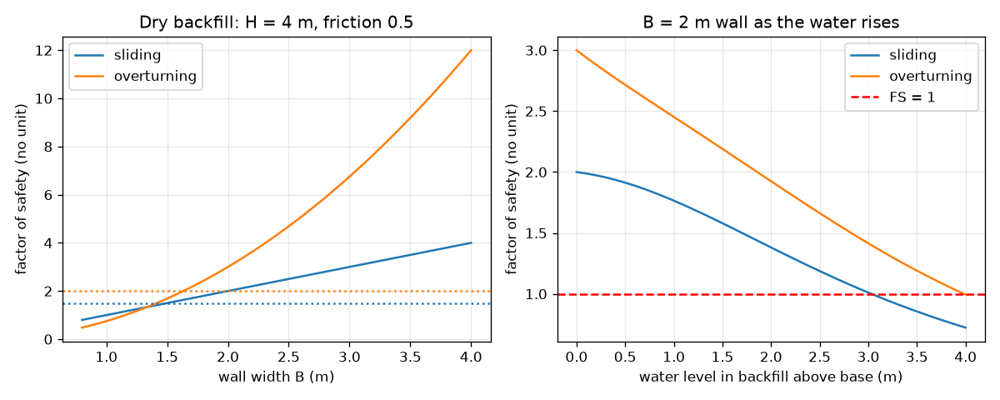
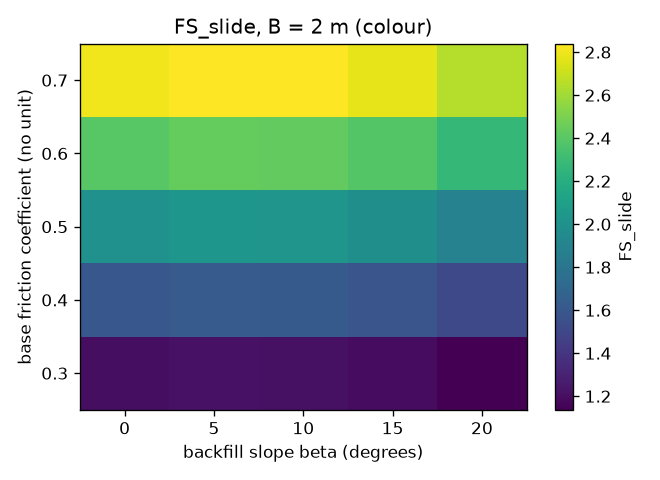

# Session 3: Sliding, overturning, the middle third and water

*Level 3 (simulation and validation) · about 90 minutes · openretainingwall*

> This is a simplified educational model. It is not a validated design tool and must not be used for real structures, electrical installations, vehicles, industrial processes or medical decisions.

**Prerequisites**

- Session 1: sliding and tipping ratios.
- Session 2: Rankine earth pressure, surcharge and water.

**Learning objectives.** After this session you can:

- Compute the factor of safety against sliding and against overturning for a gravity wall, with its stated assumptions.
- Find the position of the resultant on the base, the eccentricity and the base pressure, and apply the middle-third rule.
- Validate the model against closed forms, numerical integration and moment equilibrium.
- Sweep width, friction, friction angle and backfill slope, and explain how water in the backfill makes the factors of safety fall below 1.

## A. Real-world problem
A small wall holds up a bed of soil. It must not slide, must not tip over its toe, and the pressure under its base must stay compressive, so that it does not try to lift off the ground at the heel. Rain can make all of this much worse: poorly drained soil fills with water that pushes on the wall and lifts the base. How wide must the wall be, and how much does bad drainage cost?

## B. Concept and theory
Per metre run of a rectangular gravity wall of height H and width B (weight W = gamma_c B H at B/2 from the toe) the soil force Pa acts at H/3 (Rankine, Session 2). With a backfill rising at angle beta, the Rankine force is parallel to the slope, with a horizontal part Pa cos(beta) and a vertical part Pa sin(beta) acting on the wall back. Water at height hw above the base adds hydrostatic push and an uplift under the base that varies from gamma_w hw at the heel to zero at the toe. Passive resistance of the soil in front of the toe is neglected, which is safe-sided. Sliding: FS_slide = mu N / Ph, where N is the net vertical force on the base. Overturning about the toe: FS_ot = M_resisting / M_overturning. The vertical resultant acts at x = (M_res - M_ot)/N from the toe, so the eccentricity from the base centre is e = B/2 - x. If e <= B/6 (the resultant is inside the middle third) the base pressure q = (N/B)(1 +- 6e/B) is compressive everywhere; if e > B/6 the heel pressure is negative (tension, which soil cannot provide). Commonly used guidance, not a code: FS_slide at least about 1.5 and FS_ot at least about 2.0. Coulomb theory allows a rough or leaning wall (wall friction delta, wall inclination alpha): Ka = cos^2(phi - alpha) / (cos^2(alpha) cos(alpha + delta) [1 + sqrt(sin(phi + delta) sin(phi - beta) / (cos(alpha + delta) cos(alpha - beta)))]^2). It reduces to Rankine when delta = alpha = beta = 0, which the checkpoint verifies.

| Symbol | Meaning | Unit |
|---|---|---|
| B | base width of the wall | m |
| H | wall height (4 m in the lesson) | m |
| W | wall weight per metre run (gamma_c B H) | kN/m |
| Ph | horizontal force on the wall back | kN/m |
| U | uplift force under the base | kN/m |
| N | net vertical force on the base | kN/m |
| mu | friction coefficient under the base | no unit |
| e | eccentricity of the resultant from the base centre | m |
| q | pressure under the base (toe, heel) | kPa |
| hw | water level above the base | m |
| beta | backfill slope angle | degrees |

**Assumptions**

- Rectangular gravity wall, concrete unit weight 24 kN/m^3 (garden wall: 22).
- Rankine pressure on a vertical back; passive resistance and wall friction neglected.
- Uplift is a triangle from the water level at the heel to zero at the toe; no seepage calculation.
- Soil unit weight 18 kN/m^3, saturated 20 kN/m^3, water 9.81 kN/m^3.
- Safety targets 1.5 and 2.0 are commonly used guidance, not a code. This is a teaching model, never for a real wall.

$$ K_a=\cos\beta\,\frac{\cos\beta-\sqrt{\cos^2\beta-\cos^2\varphi}}{\cos\beta+\sqrt{\cos^2\beta-\cos^2\varphi}} $$

$$ FS_{slide}=\frac{\mu N}{P_h},\qquad FS_{ot}=\frac{M_{res}}{M_{ot}} $$

$$ x=\frac{M_{res}-M_{ot}}{N},\qquad e=\frac B2-x,\qquad e\le\frac B6\ \text{(middle third)} $$

$$ q_{toe,heel}=\frac NB\left(1\pm\frac{6e}{B}\right) $$

## C. Visual explanation
The first figure has two panels. On the left the safety factors of a dry 4 m wall against its width, with dotted lines at the limits 1.5 and 2.0: the overturning factor rises with the square of the width, the sliding factor linearly. On the right the 2 m wall as the water in the backfill rises: both curves fall through their limits (sliding below 1.5 at 1.70 m and overturning below 2 at 1.86 m) and the overturning factor reaches 0.99 when the backfill is saturated. The second figure is a map of the sliding factor against friction coefficient and backfill slope: the factor rises in proportion to friction and changes little with the slope.

*Left: safety factors against wall width (dry). Right: a 2 m wide wall as the water rises: both factors fall through their limits.*

*Sliding factor of the 2 m wall against friction coefficient and backfill slope.*

## D. Interactive simulation
Run the lesson (`python start.py 3`), then open the live app: [Session 3: will the wall pass? (4 m wall)](https://krunalpanchal1995.github.io/openretainingwall/session-03/) (or `app.html` in this folder). Move the width, friction and friction angle sliders, then raise the water level and watch the push arrow, the pressure under the base and the two factors of safety. The wall turns green while it passes all three checks.

**Challenge.** With the water level at 2 m, choose the wall width (and keep friction at least 0.5 and phi at least 30 degrees) so that the wall passes all three checks.

## E. Worked example and experiment
**Problem.** A wall 4 m high and 2 m wide (concrete 24 kN/m^3) holds dry soil (gamma = 18 kN/m^3, phi = 30 degrees), with base friction 0.5. Find both factors of safety, the eccentricity and the base pressures. Then fill the backfill with water to the top.

1. Pa = 0.5 x (1/3) x 18 x 16 = 48 kN/m at 1.33 m, so M_ot = 48 x 1.333 = 64 kN m/m. W = 24 x 2 x 4 = 192 kN/m, M_res = 192 x 1 = 192 kN m/m.
2. FS_slide = 0.5 x 192 / 48 = 2.00. FS_ot = 192 / 64 = 3.00. Both are above 1.5 and 2.0.
3. x = (192 - 64) / 192 = 0.667 m from the toe, so e = 1.0 - 0.667 = 0.333 m, exactly B/6 = 0.333 m: the resultant is at the edge of the middle third.
4. q_toe = (192 / 2) x (1 + 6 x 0.333 / 2) = 96 x 2 = 192 kPa and q_heel = 96 x (1 - 1) = 0.
5. Saturated to the top: soil 27.17 kN/m plus water 78.48 kN/m give Ph = 105.65 kN/m. Uplift U = 0.5 x 9.81 x 4 x 2 = 39.24 kN/m acting 2B/3 = 1.33 m from the toe.
6. M_ot = 105.65 x 1.333 + 39.24 x 1.333 = 193.19 kN m/m, so FS_ot = 192 / 193.19 = 0.994. FS_slide = 0.5 x (192 - 39.24) / 105.65 = 0.72.

**Answer.** Dry: FS_slide 2.00, FS_ot 3.00, e = 0.333 m = B/6, toe pressure 192 kPa and heel pressure 0. Saturated: FS_slide 0.72 and FS_ot 0.994, both below 1, so the wall slides and tips.

**Experiment.** Build a small model wall from stacked bricks or a block of wood on a table (the base friction), lean a board of sand-filled box against it and measure how much sideways force a spring balance needs to start it sliding; compare mu times the weight divided by the push. Then wet the sand and repeat. The model predicts the trend (water makes failure far easier) but not the number: real friction at the base varies, the soil behind a wall is never exactly at the active state, water takes time to build up and drain, and seepage changes the uplift. The model gives a clean upper-level estimate, not the real behaviour.

## Real-world application and mini-project: Size the base width of a small garden wall
A garden wall holds up a 1.2 m high bed of soil (unit weight 18 kN/m^3, friction angle 30 degrees). The wall is masonry with unit weight 22 kN/m^3, friction under the base is 0.45, and a 5 kPa surcharge covers people sitting on the bed. Use `wall_state` and `min_width` from Session 3 to find the smallest base width (in steps of 0.05 m) that gives FS_slide of at least 1.5, FS_ot of at least 2.0 and a resultant inside the middle third. Then repeat with water standing 0.6 m and 1.2 m deep behind the wall to see what bad drainage costs.

**Deliverable:** A script that prints the factor of safety table for widths 0.60 to 1.00 m, names the smallest passing width for the dry, half-wet and saturated cases, saves a figure of the safety factors against width, and explains in two sentences which of the three checks controls the dry design.

**Success looks like:** The dry design is 0.85 m (FS_slide 1.60, FS_ot 3.26, resultant inside the middle third), water 0.6 m deep needs 1.10 m and a saturated backfill needs 1.90 m. At 0.80 m both factors pass but the middle-third rule fails, so that rule controls.

## F. Assessment and design challenge
**Question type A: Conceptual.** Why does water in the backfill reduce both the sliding and the overturning factors, and why is drainage behind a wall so important?

Hint

Think of the extra horizontal push and of what the water under the base does to the vertical force.

Step-by-step solution

Water adds hydrostatic push 0.5 gamma_w hw^2, which acts on top of the (reduced) soil push, so the horizontal force and the overturning moment both rise. It also creates uplift under the base, which lowers the net vertical force (reducing friction) and adds an overturning moment about the toe. Drains and weep holes keep the water level low, so they remove the largest load acting on the wall.

**Question type B: Numerical.** A wall 3 m high and 1.6 m wide (concrete 24 kN/m^3) holds dry soil (gamma = 18, phi = 30 degrees), base friction 0.5. Find FS_slide, FS_ot, the eccentricity and whether the resultant is in the middle third.

Hint

Pa = 0.5 x (1/3) x 18 x 9 = 27 kN/m at 1 m. W = 24 x 1.6 x 3.

Step-by-step solution

W = 115.2 kN/m, FS_slide = 0.5 x 115.2 / 27 = 2.13. M_res = 115.2 x 0.8 = 92.16 and M_ot = 27 x 1 = 27 kN m/m, so FS_ot = 3.41. x = (92.16 - 27) / 115.2 = 0.566 m, e = 0.8 - 0.566 = 0.234 m, and B/6 = 0.267 m, so e < B/6: inside the middle third. The base pressures are 135.3 kPa at the toe and 8.7 kPa at the heel.

**Question type C: Graph and simulation interpretation.** In the right panel of the first figure (a 2 m wide wall), at what water levels does the sliding factor fall below 1.5 and 1? At what level does the overturning factor fall below 2 and 1? Which factor fails first?

Hint

Read the crossing points of each curve with its limit line, or find them with the bisection in the checkpoint.

Step-by-step solution

Sliding falls below 1.5 at 1.70 m and below 1 at 3.03 m. Overturning falls below 2 at 1.86 m and below 1 at 3.98 m. The sliding factor falls to 1 first (3.03 m), so the wall would slide before it tips. Both guidance limits are lost before the water is half-way up the 4 m backfill.

**Question type D: Design and optimisation challenge.** Design: for a 4 m wall with base friction 0.5 (phi = 30 degrees), find the smallest width in steps of 0.05 m that passes all three checks (FS_slide >= 1.5, FS_ot >= 2.0, e <= B/6) for a dry backfill, and with water 2 m deep. Discuss the cost of poor drainage.

Hint

Use `min_width(4, 0.5, 30, 18)` and the same with `hw=2.0`.

Step-by-step solution

Dry: 2.00 m (the middle-third rule decides, with e exactly B/6). Water 2 m deep: 2.45 m. The undrained wall needs 0.45 m more width, 22.5 percent more concrete than the dry design. If the backfill is saturated to the top, 4.15 m is needed. Drains are cheaper than the extra concrete; the trade-off is the maintenance of the drains (they can clog).

Score yourself with [RUBRIC.md](../../RUBRIC.md). Print the [activity sheet](activity_sheet.md) to work on paper.

## Common misconceptions
| Common misconception | What is actually true |
|---|---|
| If both factors of safety are above their limits the wall is safe. | The resultant must also lie inside the middle third (e <= B/6); a wall can pass sliding and overturning and still have tension at the heel. |
| Safety factors of 1.5 and 2 are laws of nature. | They are commonly used guidance; real codes and soil investigation decide what is required. |
| A steeper backfill slope always makes sliding much worse. | In this model the push rises but its vertical part adds to the weight, so FS_slide stays within about 6 percent for slopes up to 20 degrees. |
| Neglecting passive resistance in front of the wall is an error. | It is a deliberate safe-sided simplification, because soil in front of a toe can be removed or soft. |

## Glossary
- **factor of safety**: capacity divided by demand; below 1 means failure
- **eccentricity e**: distance of the resultant force from the centre of the base
- **middle third**: the central third of the base; a resultant inside it gives compression everywhere
- **uplift**: upward water pressure under the base
- **Coulomb theory**: earth pressure theory that allows wall friction and a leaning wall

## Finish
1. Do the three coding tasks in [exercises.md](exercises.md).
2. Run `python start.py 3` again after your changes. It ends with the checkpoint; when it prints `PASS`, you are done. (Checkpoint only: `python start.py check 3`.)

Next: the [roadmap](../../promo/roadmap.md). Session 4 is yours to build.
